# 事序 SHIXU

[打开事序介绍网站](https://zstdjan.github.io/shixu/)

事序是一款 Windows 桌面软件，用于收集信息、记录日志、安排待办和跟进事项。汇报或交接时，可以导出 PDF、Word 或带原始附件的资料包。

记录和材料保存在电脑上的事项库中，可以整库备份和迁移。

[下载与环境](#下载与环境) · [功能](#功能) · [功能配图](#功能配图) · [首次使用](#首次使用) · [反馈与支持](#反馈与支持)

## 下载与环境

个人开发，免费使用。已验证环境为 **Windows 11 x64**。

公开下载暂未开放。

## 功能

- **总览工作台** — 把日历、待办、关注事项和常用工具放在一起，按需调整组件。
- **待办与四象限** — 用列表查看详情，用四象限安排优先级。两个视图共用同一份待办。
- **日历** — 按年、月、周查看排期，设置重复待办和提醒。
- **快速收集** — 用快捷键把其他软件里的文字、图片和文件存成收集卡。
- **收集板** — 分区整理卡片，从卡片内容创建待办或事项。
- **随记** — 按日期写图文记录，可以回看、导出和打印。
- **事项与过程** — 在同一个事项里记录进展、经过、待办和相关材料。
- **资料包交接** — 把所选事项、过程记录和原始附件打包交接。
- **导出模板** — 保存常用版式和字段，换一组内容继续生成 PDF 或 Word。
- **主题与配色** — 自选主色、背景和明暗模式。
- **独立事项库** — 备份或换机时，可以把记录、材料和库内布局一起带走。
- **AI 连接** — 通过 MCP 连接兼容的 AI 客户端读取当前事项库。授权写入后，可创建或修改记录。

## 功能配图

点击图片查看原图。

[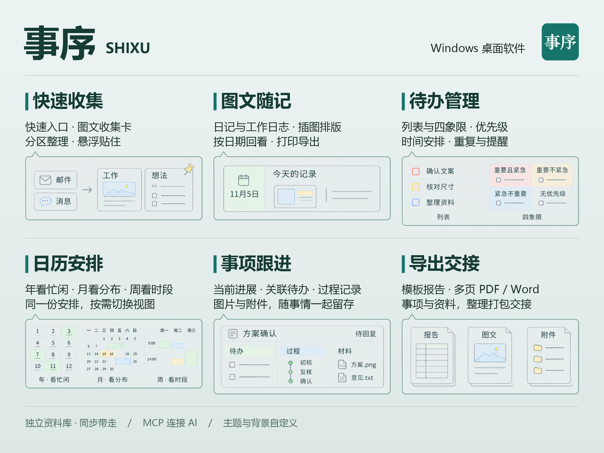](assets/00-cover.png)

<table class="gallery">
<tr>
<td width="50%"><a href="assets/01-workbench.png">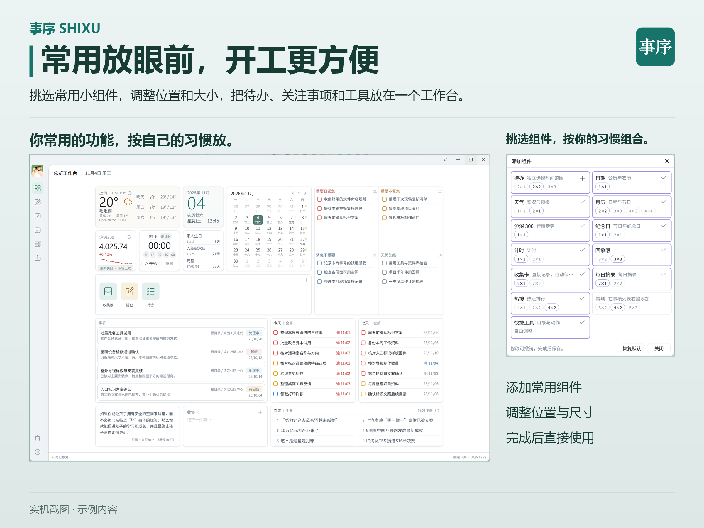</a> 总览工作台</td>
<td width="50%"><a href="assets/02-tasks.png">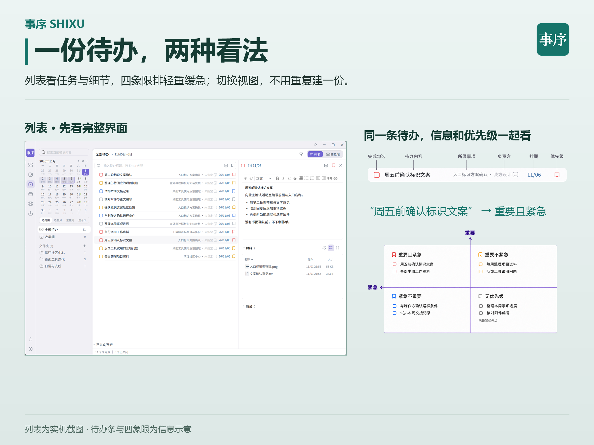</a> 待办列表与四象限</td>
</tr>
<tr>
<td width="50%"><a href="assets/03-calendar.png">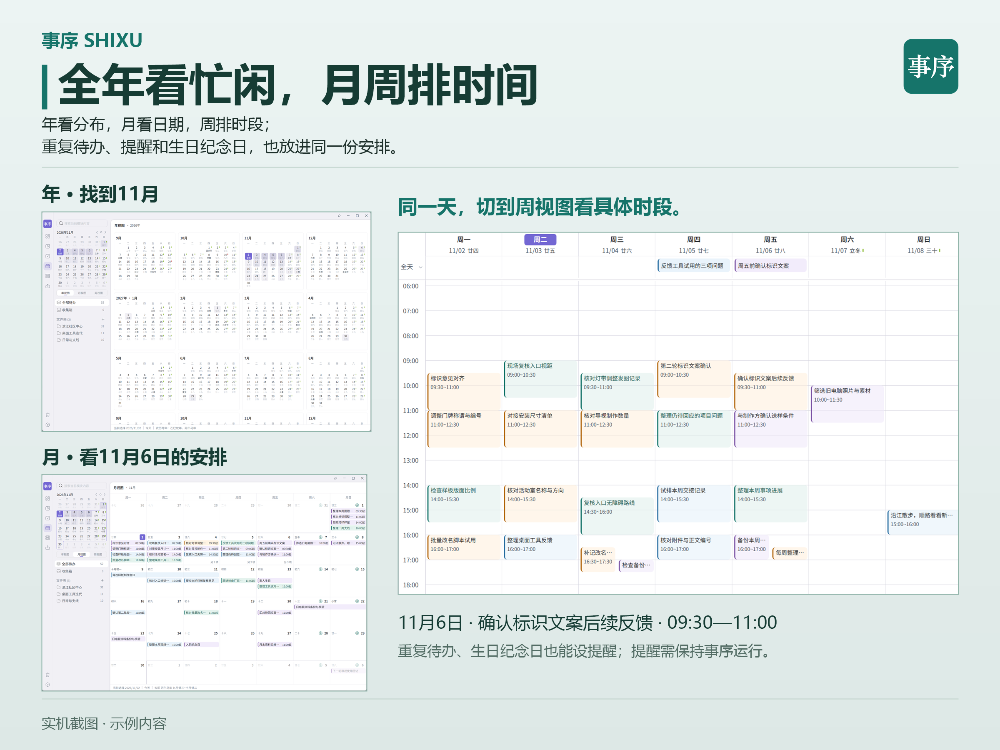</a> 年、月、周日历</td>
<td width="50%"><a href="assets/04-quick-capture.png">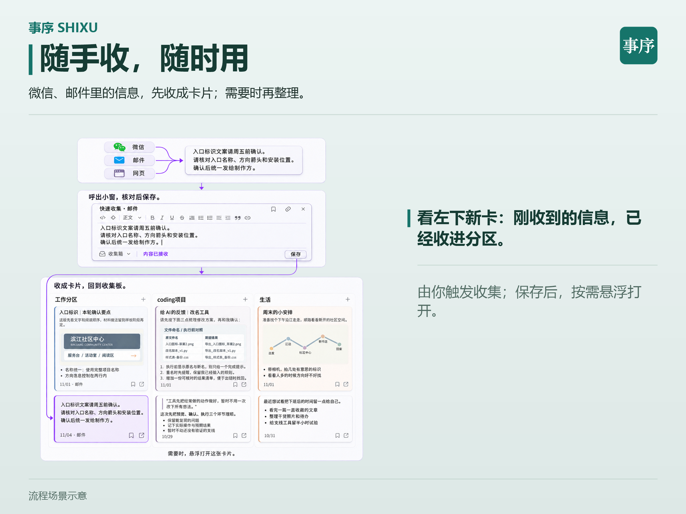</a> 快速收集</td>
</tr>
<tr>
<td width="50%"><a href="assets/05-collection-board.png">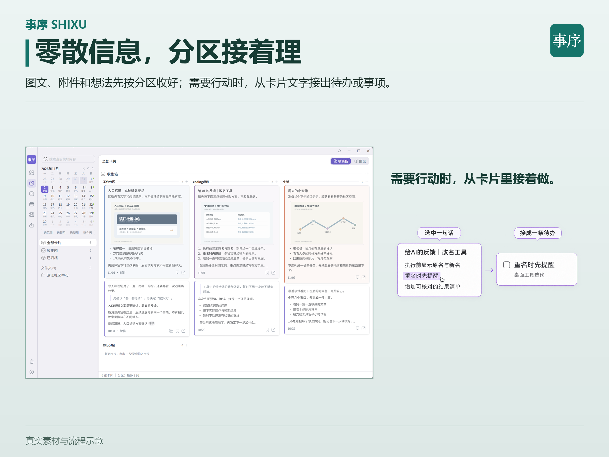</a> 收集板</td>
<td width="50%"><a href="assets/06-journal.png">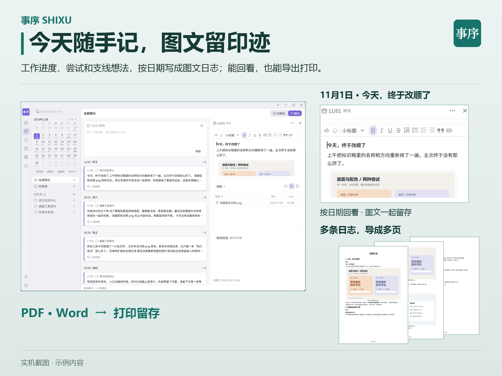</a> 图文随记</td>
</tr>
<tr>
<td width="50%"><a href="assets/07-issues.png">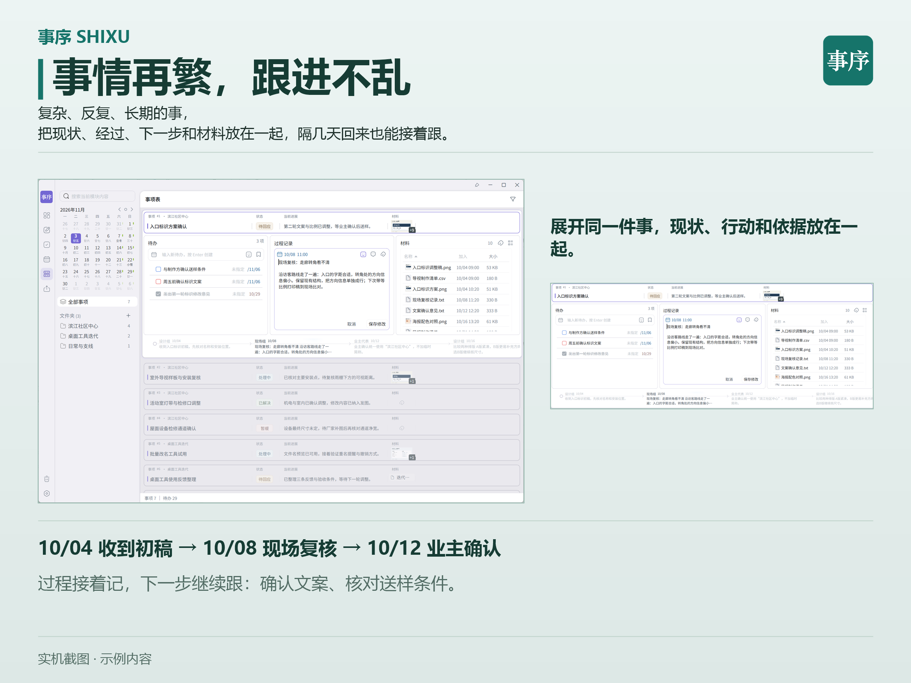</a> 事项与过程</td>
<td width="50%"><a href="assets/08-handover.png">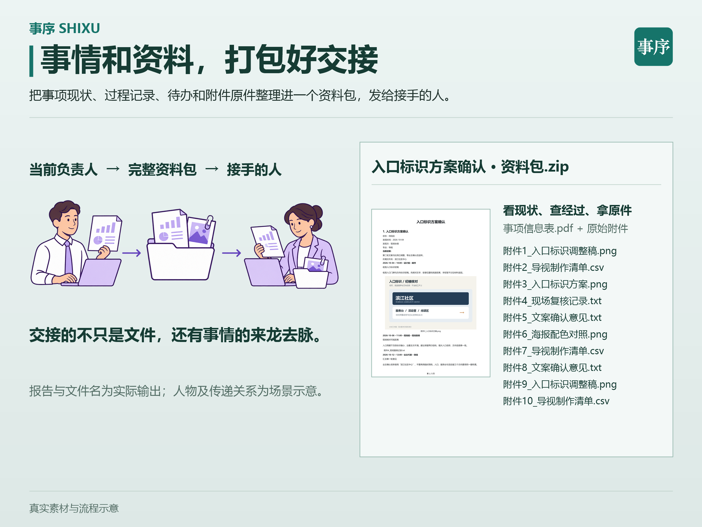</a> 资料包交接</td>
</tr>
<tr>
<td width="50%"><a href="assets/09-export-template.png">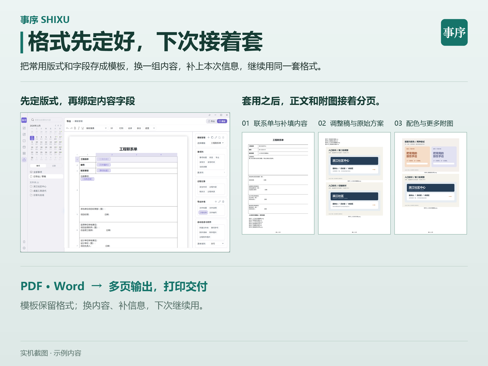</a> 导出模板</td>
<td width="50%"><a href="assets/10-themes.png">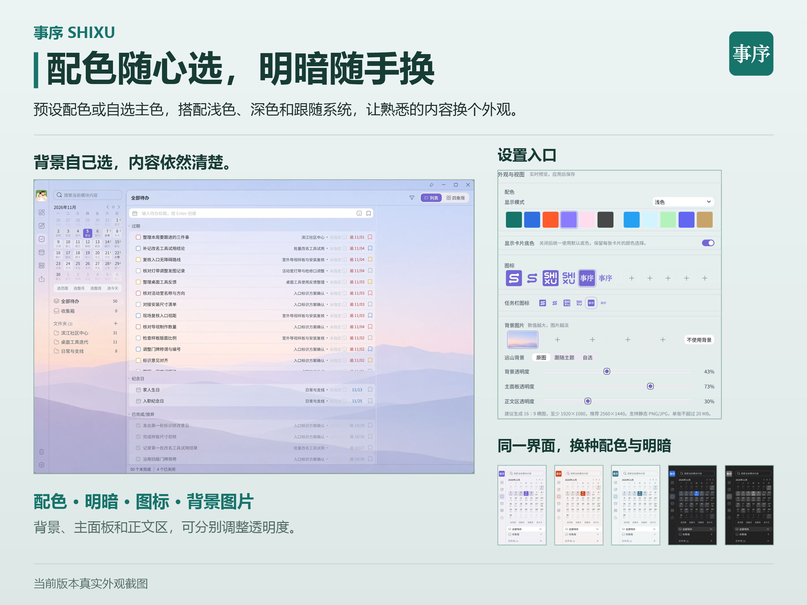</a> 主题与配色</td>
</tr>
<tr>
<td width="50%"><a href="assets/11-library.png">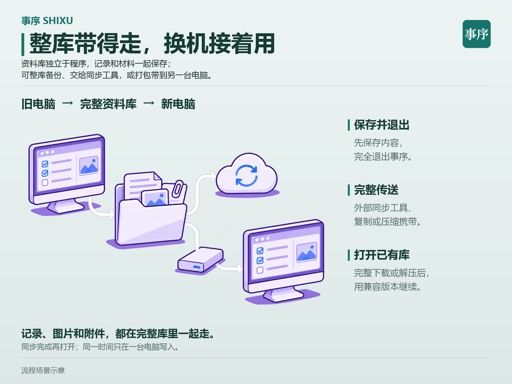</a> 独立事项库</td>
<td width="50%"><a href="assets/12-mcp.png">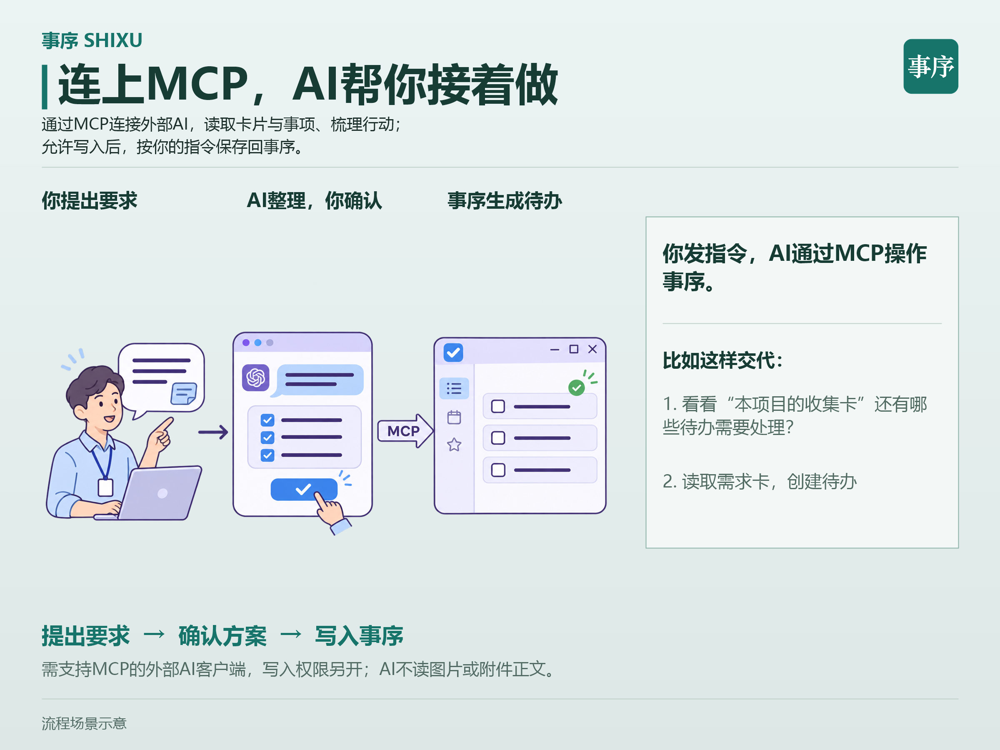</a> 通过 MCP 连接 AI</td>
</tr>
</table>

## 首次使用

1. 第一次打开时，新建事项库。如果已有资料，选择「打开已有事项资料库」，选中整个库文件夹。
2. 新建后进入总览，点击「快速上手」，打开第一张示例卡。
3. 跟着卡片做一次操作，例如把一段文字收成卡片，或安排一条待办。

[查看使用手册](https://zstdjan.github.io/shixu/manual.html#首次使用)

## 反馈与支持

### 交流与反馈

- QQ 群「事序-交流」 · **89641678**
- 反馈邮箱 · [w.jan@FOXmail.com](mailto:w.jan@FOXmail.com)

反馈问题时，可以附上事序版本和复现步骤。

### 支持事序

如果事序对你有帮助，欢迎在 GitHub 点亮 Star，也可以扫码赞助。

<table class="support-codes">
<tr>
<td align="center"> 微信</td>
<td align="center"> 支付宝</td>
</tr>
</table>
